# 2D Platformer

A 2D platformer developed independently using **Unity and C#**, featuring responsive player movement, multiple enemy AI behaviours, physics-based rope mechanics, interactive environments, collectible-based progression, dynamic hazards and checkpoints.

## Play the Game

Download the latest Windows build:

[Download Platformer v1.1.0](https://github.com/gati-game-dev/2D-Platformer/releases/tag/v1.1.0)

---

  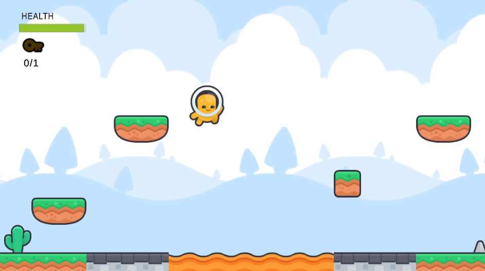

  **Unity | C# | 2D Game Development**

---

## 🎮 Gameplay Showcase

A look at the core gameplay mechanics and systems implemented in the game.

### Boss AI
<!-- Replace with your boss AI GIF -->

  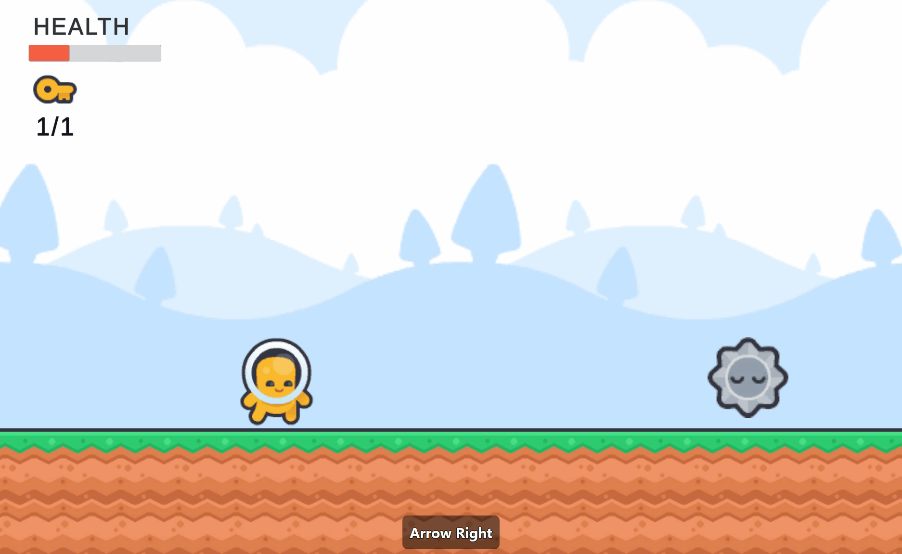

Boss encounter featuring an awakening sequence, player tracking, periodic jumping, and collision-based damage.

### Enemy AI
<!-- Replace with your enemy AI GIF -->

  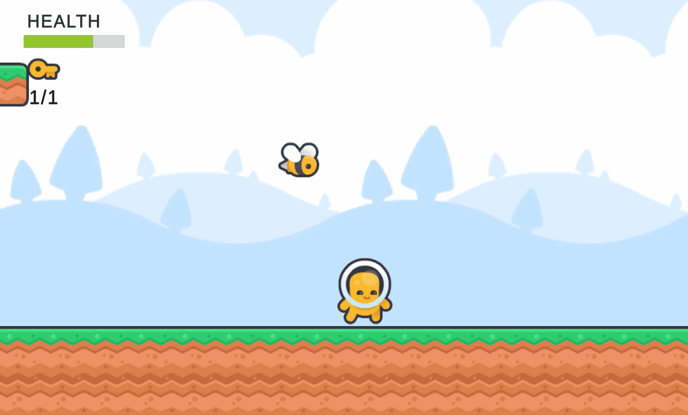

Multiple enemy behaviours, including bee hovering and chasing, fish jumping attacks, and snail patrol behaviour with conditional movement.

### Rope Mechanics
<!-- Replace with your rope mechanics GIF -->

  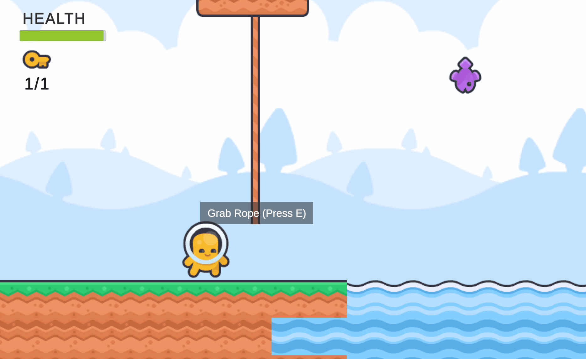  
  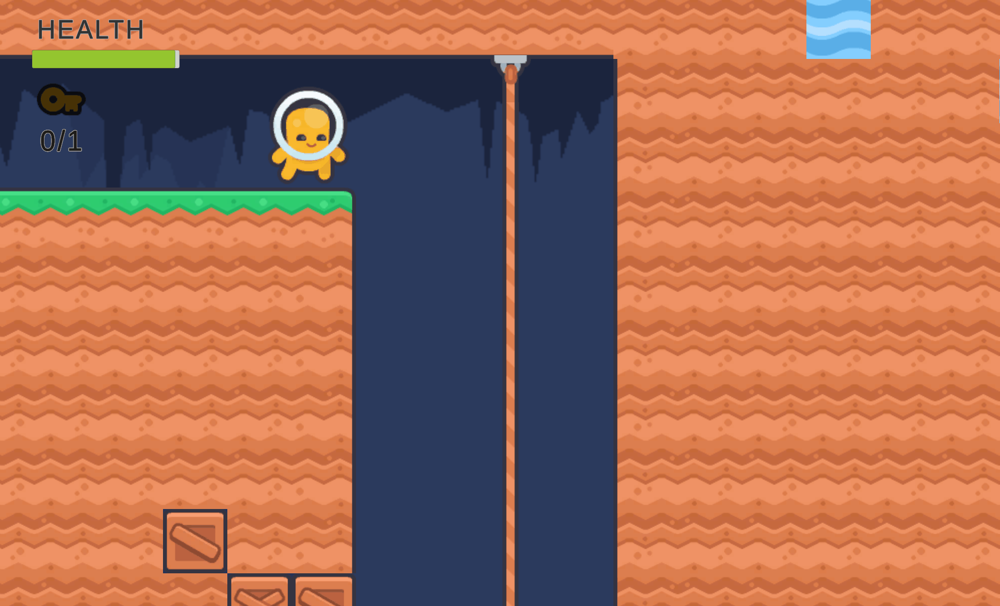

Physics-based rope interactions featuring climbing, swinging, directional control, and momentum-preserving detachment.

### Environmental Hazards
<!-- Replace with your hazards GIF -->

  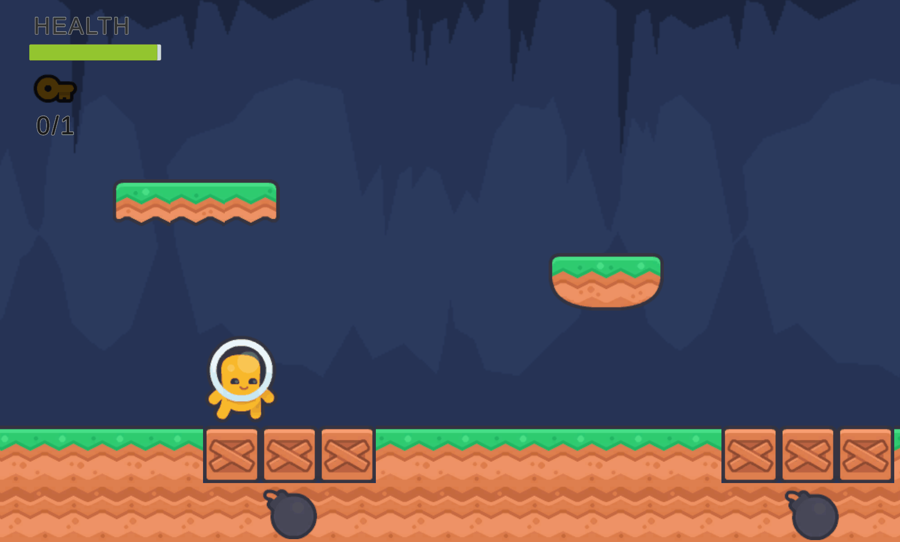  
  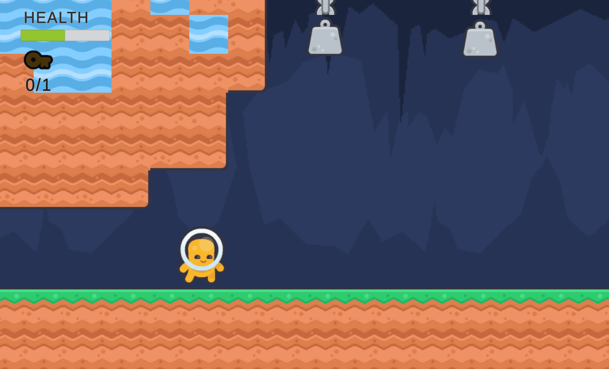

Interactive hazards including proximity-triggered bombs, falling blocks, and falling weights, with different damage and reset behaviours.

---

## 📸 Gameplay Screenshots

  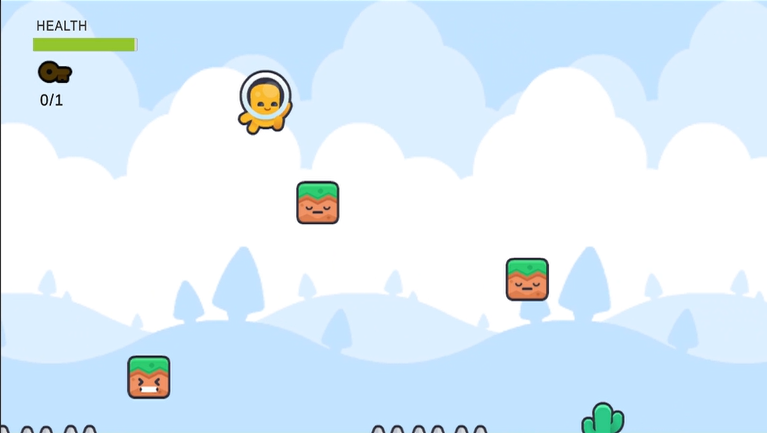
  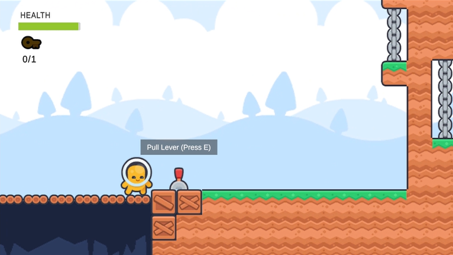

  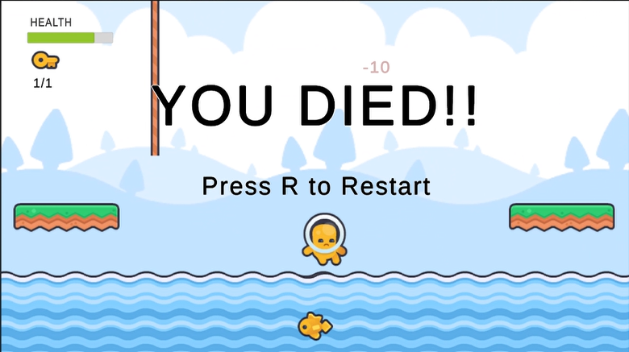
  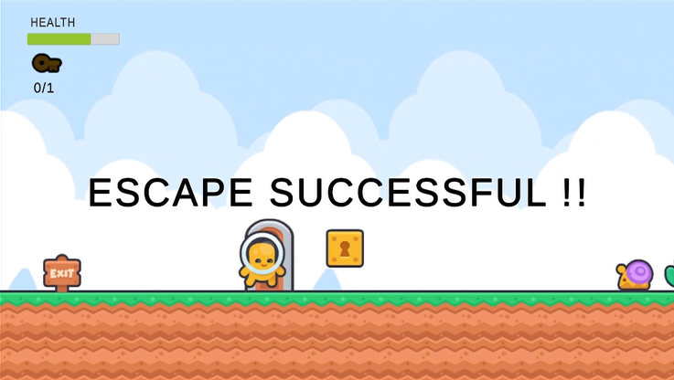

---

## ✨ Features

### 🏃 Player Movement & Mechanics
- Responsive horizontal movement and jumping.
- Ground detection using a dedicated ground-check system.
- Rope climbing and physics-based rope swinging.
- Directional swinging with momentum-preserving rope release.
- Jump-based rope detachment.
- Spring-based boosted jumps.
- Player health, damage, and hit animation systems.
- Death state with a dedicated UI and restart functionality.

### 🤖 Enemy AI

Multiple enemies with distinct movement, detection, and attack behaviours.

- **Bee:** Idle hovering followed by player detection and chasing behaviour.
- **Fish:** Periodic jumping attacks from water, damaging the player on contact.
- **Snail:** Patrol movement with conditional stopping when the player approaches.
- **Saw Boss:** Awakening sequence, horizontal player tracking, periodic jumping, and collision-based damage.

### 🪢 Rope Mechanics
- Physics-based swinging implemented using Unity's `DistanceJoint2D`.
- Rope attachment based on player proximity.
- Horizontal movement controls swinging direction.
- Releasing the rope preserves player momentum.
- Jump-based detachment.
- Dynamic rope visuals and reusable rope prefabs.

### 🎯 Interactive Objects
- Lever-based environmental interactions.
- Moving platforms.
- Spring mechanisms.
- Key-locked exit door.
- Proximity-based interaction prompts and input handling.

### 🔑 Collectibles & Progression
- Collectible keys required for level progression.
- Key collection tracked and displayed through the UI.
- Exit door unlocks after collecting all required keys.
- Key collection triggers environmental changes and object reset operations.

### 📍 Checkpoint System
- Multiple checkpoints distributed throughout the level.
- Checkpoints activate when reached by the player.
- Player respawns at the most recently activated checkpoint after death.
- Collected keys and their UI state persist across deaths and checkpoint respawns.
- Progression is maintained when moving between checkpoints, preventing previously collected items from being lost.

### 💥 Health & Environmental Hazards
- Player health system with different damage values depending on the hazard or enemy.
- Damage from enemies and environmental hazards.
- Spikes and lava pits with instant-death behaviour.
- Falling blocks and weights.
- Proximity-triggered bombs.
- Dedicated death screen and level restart functionality.

### 🔄 Environmental Reset System

A centralized GameManager coordinates the resetting of environmental objects when progression conditions are met.

- Falling blocks return to their original positions and restore their visual states.
- Falling weights are repositioned and their physics states restored.
- Bombs reset their activation and visual states.
- Springs and other registered environmental objects can be reset.
- Reset operations are coordinated through a persistent GameManager.

This allows environmental objects to be reused and ensures that the level responds consistently to key collection.

---

## 🛠️ Technical Implementation

The project incorporates several Unity systems and programming concepts:

| System | Implementation |
|---|---|
| 2D Physics | `Rigidbody2D`, `Collider2D`, `DistanceJoint2D` |
| Enemy AI | Detection, chasing, patrolling, timed jumping |
| Animation | Animator parameters, state transitions, animation events |
| Level Design | Unity Tilemap System |
| Game Management | Singleton Pattern |
| Scene Management | `DontDestroyOnLoad`, scene-loading callbacks |
| Object Management | Reusable prefabs and centralized reset logic |
| Checkpoint System | Checkpoint activation, respawn positioning, persistent gameplay progress |
| UI | Health, collectibles, interaction prompts, death screens |
| Gameplay Interactions | Triggers, collision detection, proximity checks |

---

## 🧰 Built With

- **Unity** – Game engine
- **C#** – Gameplay programming and scripting
- **Unity 2D Physics** – Physics-based movement and interactions
- **Unity Animator** – Character and enemy animations
- **Unity Tilemap System** – Level construction

---

## 🎮 Controls

| Input | Action |
|---|---|
| A / D or Arrow Keys | Move |
| W / S or Arrow Keys | Rope Climbing |
| Space | Jump |
| E | Interact / Grab or Release Rope |
| R | Restart after death |

---

## 📦 Project Status

**Completed**

The core gameplay systems, enemy behaviours, environmental interactions, collectibles, hazards, checkpoint-based respawning, and progression mechanics have been implemented.

This project represents an independently developed game, focusing on gameplay programming, physics-based mechanics, AI behaviour, object management, and building interconnected gameplay systems.

---

**Developed independently using Unity and C#.**